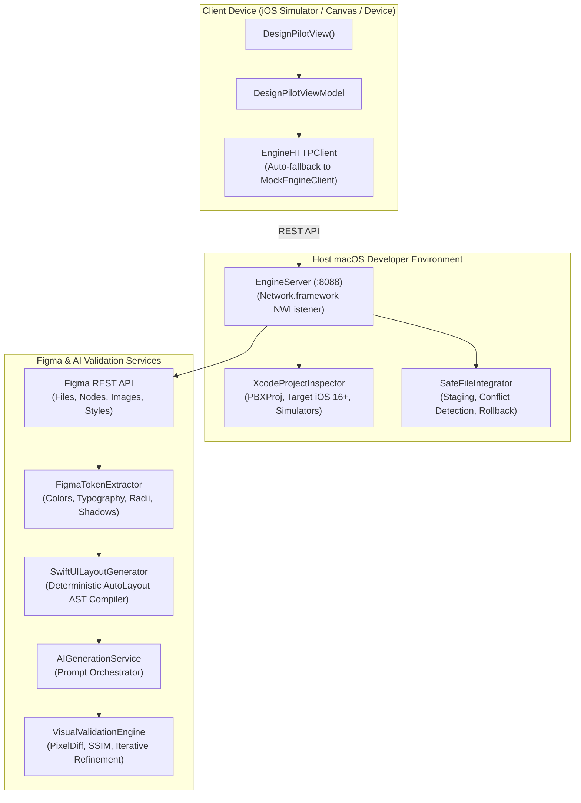

# DesignPilot SDK — AI-Powered Figma-to-Xcode UI Generator

[](https://swift.org)
[](https://apple.com)
[](#architecture)
[](LICENSE)

DesignPilot is an enterprise-grade AI-powered Design-to-Code system that allows iOS developers to convert Figma designs directly into native, reusable, and responsive UI code for existing Xcode projects.

The developer integration experience is intentionally minimal:

```
Import Library ➔ Add One View ➔ Paste Figma URL ➔ Tap Save ➔ Generate UI ➔ Preview & Diff ➔ Validate ➔ Integrate
```

---

## 1. Quick Integration (1-Line Developer Setup)

Add `DesignPilotSDK` via Swift Package Manager:

```swift
dependencies: [
    .package(url: "https://github.com/DesignPilot/DesignPilotSDK.git", from: "1.0.0")
]
```

Display the ready-made interface using a single view:

```swift
import SwiftUI
import DesignPilotSDK

struct ContentView: View {
    var body: some View {
        DesignPilotView()
    }
}
```

The ready-made [`DesignPilotView`](Sources/DesignPilotSDK/Public/DesignPilotView.swift) provides:
* **Figma URL Input Field** with clipboard paste support and live format validation.
* **Distinct Save URL & Generate UI actions**: Saving URL is completely decoupled from initiating the generation pipeline.
* **Pipeline Progress Tracker**: Real-time multi-step progress indicator (`Validating` ➔ `Figma Fetch` ➔ `Xcode Project Inspection` ➔ `Adaptive Code Synthesis` ➔ `Visual Validation` ➔ `Ready for Review`).
* **Visual Accuracy Comparator**: Side-by-side reference canvas vs simulator snapshot, visual discrepancy reporting (spacing, typography, color), and similarity score (e.g., `98.4%`).
* **Staged Code Diff Viewer**: Syntax-highlighted view code, line numbering, one-click copy, and file checklist.
* **Non-Destructive Integration & Rollback**: Creates an atomic snapshot backup before writing any file to your Xcode project.

---

## 2. Architecture: 3-Tier Design

DesignPilot strictly separates concerns into 3 independent but connected components:



### A. DesignPilotSDK (Swift Package Target)
* Target platforms: iOS 16+, macOS 14+
* Zero third-party dependencies (pure native Foundation & SwiftUI).
* Manages UI, URL validation state machine, pipeline tracking, diff review sheets, and client bridge.
* Built-in `MockEngineClient` allows full UI and visual diff testing inside Xcode Canvas Previews without needing the daemon online.

### B. DesignPilot Engine (macOS Library Target)
* macOS developer-side generation engine.
* **Figma Client**: Authorized REST API integration (`/v1/files`, `/v1/files/nodes`, `/v1/images`).
* **AutoLayout Parser**: Converts Figma AutoLayout hierarchy into semantic AST (`LayoutBox`, `HStack`, `VStack`, `ZStack`, sizing rules: `Fixed`, `Hug`, `Fill`).
* **Xcode Inspector**: Discovers deployment targets, Swift version, existing directory conventions, and active iOS simulators.
* **Safe Integrator**: Staged isolation in `.designpilot/staging/`, conflict detection, and snapshot backups in `.designpilot/backups/<backupId>/`.
* **Daemon Server**: Ultra-low-overhead HTTP daemon powered by Apple's `Network.framework` (`NWListener`).

### C. AI & Validation Services
* **Deterministic Layout Compiler**: Guarantees valid Swift 6 SwiftUI views even in air-gapped or offline environments.
* **AI Generation Layer**: Integrates Claude / OpenAI / Gemini for semantic subview decomposition and accessibility enrichment.
* **Visual Validation Engine**: Compares rendered frames with Figma reference images, calculates visual similarity percentage, and runs an iterative refinement loop until the acceptance threshold (e.g. 95%) is satisfied.

---

## 3. Developer Workflow

```
1. Paste URL       ➔ User inputs https://www.figma.com/design/:key/:title?node-id=...
2. Save URL        ➔ Validates format and checks token permissions without generating.
3. Tap Generate    ➔ Triggers the multi-step background engine pipeline.
4. Auto Inspection ➔ Engine queries Xcode project targets and available simulators.
5. Code Synthesis  ➔ AutoLayout AST compiler produces adaptive, responsive SwiftUI code.
6. Visual Validate ➔ Calculates pixel diff and structural similarity (SSIM).
7. Review & Diff   ➔ Developer inspects code, tokens, and visual comparison in modal sheet.
8. Safe Commit     ➔ Atomic snapshot created; files written to project; one-click rollback ready.
```

---

## 4. macOS Command-Line Interface (`designpilot`)

The package includes a native CLI tool for macOS terminals and CI/CD pipelines:

```bash
# 1. Start the background Engine daemon
designpilot daemon --port 8088

# 2. Inspect target Xcode project
designpilot inspect --path .

# 3. Generate SwiftUI screen directly from CLI
designpilot generate "https://www.figma.com/design/KEY/ScreenTitle?node-id=0:1" --output Views/Generated

# 4. Generate native UIKit ViewController
designpilot generate "https://www.figma.com/design/KEY/ScreenTitle?node-id=0:1" --framework uikit --output Views/Generated

# 5. Rollback to any previous snapshot
designpilot rollback --backup-id backup_1791990751
```

---

## 5. Security & Credentials

* **Zero Embedded Secrets**: API tokens and AI keys are never bundled into the distributed iOS SDK binary.
* **Keychain & Environment Resolution**:
  * Set `FIGMA_ACCESS_TOKEN` in your macOS shell or pass it securely in the SDK Settings sheet.
  * Set `DESIGNPILOT_API_KEY` or `OPENAI_API_KEY` in your environment for AI-assisted refinement.
* **Non-Destructive File Guarantee**: The engine never silently overwrites project files. Every file integration is staged first in `.designpilot/staging/`, audited for conflicts, and backed up in `.designpilot/backups/`.

---

## 6. Test Suite & Verification

Run the comprehensive unit test suite:

```bash
swift test
```

Test coverage includes:
- [x] **`FigmaURLTests`**: Design and File URL formats, query parameters, dash/colon node ID normalization, error detection.
- [x] **`AutoLayoutTranspilerTests`**: AutoLayout AST parsing, token extraction (colors, fonts, radii, shadows), SwiftUI generation, UIKit generation.
- [x] **`SafeFileIntegratorTests`**: Isolated staging, destination conflict detection, atomic snapshot creation, rollback restoration.
- [x] **`VisualValidationTests`**: Similarity percentage calculation, discrepancy classification, acceptance threshold checking.
- [x] **`ViewModelTests`**: State machine transitions, Save URL isolation, end-to-end generation, file integration.
